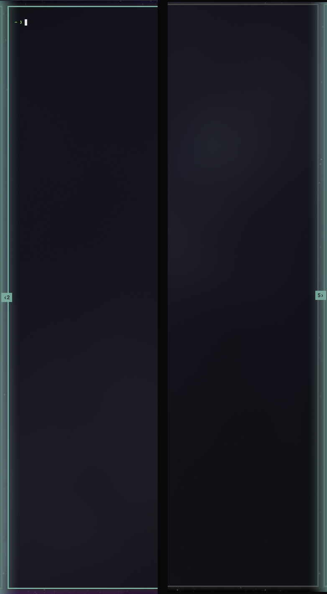

# Scroll edges

An [Omarchy](https://omarchy.org) shell plugin for the scrolling layout: when a
workspace has windows parked past the side of the screen, the edge they went
past lights up in your theme's accent color and a small pill says how many.

The scrolling layout keeps a workspace's windows in one long row and shows the
slice that fits. Whether anything is out there is normally only legible as a
few pixels of window peeking in at the edge — on an ultrawide, easy to miss
entirely. This replaces that sliver with something you can see without looking
for it.



## Install

```sh
omarchy plugin add https://github.com/nodrej/omarchy-scroll-edges.git --enable
```

The indicators run as a service. An optional bar icon opens the settings window;
new installations enabled with the command above place it in the right section.

## Usage

Nothing to press. Scroll the row as usual and the indicators follow:

- **One indicator per edge, per monitor.** A glow bleeding inward from the
  edge, and a pill with an arrow pointing the way the windows went: `‹3` on the
  left, `4›` on the right. Rotated monitors scroll top to bottom and get `⌃3`
  and `4⌄` instead; each axis is judged on its own, so nothing special is
  needed for them.
- **Only the active workspace of each monitor**, counted from Hyprland's own
  view of where the windows are, so a monitor showing everything shows nothing.
- **Windows, not columns.** Two windows stacked in one off-screen column count
  as two.
- **Floating windows are ignored** — one dragged half off-screen says nothing
  about how many columns the row holds — and a fullscreen or maximized window
  stands the indicators down, since it covers the row they annotate.
- The indicators are click-through, sit under fullscreen windows, and stay
  inside the bar's reserved area, so the glow stops at the bar instead of
  tinting it.
- Colors come from the active Omarchy theme's accent and change with it,
  unless you pin your own (see below).

## Configure

### Bar icon

Left-click the arrows icon to toggle the settings window. It uses the bar's
active color while the window is open, including when opened with a shortcut.
Add it to the bar's right section (the top right with the default bar):

```sh
omarchy bar put io.github.nodrej.scroll-edges
```

To choose a spot when first adding it, for example before the tray:

```sh
omarchy bar put io.github.nodrej.scroll-edges --section right --before omarchy.tray
```

`put` leaves an icon already on the bar in place. To reposition it, use
`omarchy bar move io.github.nodrej.scroll-edges --section right --before omarchy.tray`.

**Upgrading from an earlier version:** `put` does nothing while this plugin's
entry is still in `plugins[]`, which is where versions before 1.3.0 kept it.
This moves that entry, with all its settings, to the end of the bar's right
section. It only touches `shell.json` once the new version is ready and keeps a backup.
Once the entry has moved, running it again changes nothing, backup included:

```sh
cfg=~/.config/omarchy/shell.json
id=io.github.nodrej.scroll-edges
if jq -e --arg id "$id" 'any(.plugins[]?; .id == $id)' "$cfg" >/dev/null; then
  jq --arg id "$id" '
    ([.plugins[] | select(.id == $id)] | first) as $entry
    | .plugins |= map(select(.id != $id))
    | .bar.layout.right = ((.bar.layout.right // []) + [$entry])' "$cfg" > "$cfg.new" &&
    cp "$cfg" "$cfg.bak" && cat "$cfg.new" > "$cfg" && rm "$cfg.new"
fi
```

The shell picks it up without a restart. Then use `omarchy bar move` (above)
to put the icon where you want it. To undo, `cp "$cfg.bak" "$cfg"`.

To remove just the icon and keep the indicators and settings window, move the
whole entry back from `bar.layout.<section>[]` into `plugins[]`, preserving its
keys. Restore your backup to undo a manual move. `omarchy plugin disable
io.github.nodrej.scroll-edges` disables the indicators as well as the icon.

### Settings window

Open the settings window with:

```sh
omarchy-shell shell summon io.github.nodrej.scroll-edges
```

Use `omarchy-shell shell toggle io.github.nodrej.scroll-edges` to toggle it.
For a keyboard shortcut, add an unused binding to `~/.config/hypr/bindings.lua`:

```lua
o.bind("SUPER + CTRL + G", "Scroll edges settings", "omarchy-shell shell toggle io.github.nodrej.scroll-edges")
```

Changes save automatically and apply live. Choose theme colors or enter a
`#rrggbb` or `#rgb` color, adjust the sliders, and check the preview. Invalid
hex input is marked and never saved. "Show on my screens while open" shows
sample counts on every monitor until you close the window, including with Esc.
"Reset to defaults" removes the five overrides and follows the theme again.

### Manual settings

Every tunable has a default that works; override the ones you want from this
plugin's entry in `~/.config/omarchy/shell.json`. Changes apply as soon as you
save. No restart is needed. With the icon placed, the entry lives in
`bar.layout.left[]`, `bar.layout.center[]`, or `bar.layout.right[]`; otherwise
it can live in `plugins[]`, as below. If both exist, the bar entry wins, in
left, center, right order, matching the host. The entries are not merged;
keep just one entry to avoid stale settings.

```json
{
  "plugins": [
    {
      "id": "io.github.nodrej.scroll-edges",
      "peek": 56,
      "glowSize": 44,
      "glowOpacity": 0.62,
      "color": "#ff9e64",
      "labelColor": "#1a1b26"
    }
  ]
}
```

| Key | Default | What it does |
| --- | --- | --- |
| `peek` | `56` | How many pixels of a window may still be on screen before it counts as hidden. A window showing more than this is visible enough to speak for itself. |
| `glowSize` | `44` | How far the glow reaches in from the edge, in pixels. Sized for an ultrawide; a laptop screen will want less. |
| `glowOpacity` | `0.62` | How strong the glow is at the edge itself, from `0` to `1`. It fades to nothing across `glowSize`. |
| `color` | theme accent | Color of the glow and the count pill, as `"#rrggbb"` or `"#rgb"`. Leave it out to follow the theme. |
| `labelColor` | theme background | Color of the number on the pill. Worth setting alongside a light `color`, so the count stays readable. |

A value that is missing, negative, or not a number leaves the default standing;
so does a color that isn't a hex code. Opacity belongs to `glowOpacity`, so
the colors take no alpha channel.

## Remove

```sh
omarchy plugin remove io.github.nodrej.scroll-edges
```

Removing the plugin takes its indicators, settings window, and bar icon with it.
The host removes its active configuration entry when disabling it for removal.
If you manually created duplicate entries, remove any remaining entries with
this id from both `plugins[]` and `bar.layout.<section>[]` in
`~/.config/omarchy/shell.json`.

## Requirements and dependencies

- Omarchy 4 (Quattro), whose Quickshell-based `omarchy-shell` provides the
  `qs.Commons` and `qs.Ui` modules this plugin draws with, and the
  `Quickshell.Hyprland` models it reads the window layout from.

That is the whole dependency list. The plugin starts no processes, including
`hyprctl`, downloads nothing, installs nothing, opens no network connections,
and requests no elevated privileges. The only file it reads directly is
`~/.config/omarchy/shell.json`, for the settings above. It never writes files
itself. The settings window saves this plugin's own entry through the shell's
settings API, preserving other keys in that entry.

It is built for the scrolling layout (`layout = "scrolling"` in
`~/.config/hypr/looknfeel.lua`). On the default dwindle layout it is harmless —
nothing is ever parked past an edge, so nothing ever shows.

## How it works

`ScrollEdges.qml` counts from Quickshell's own `Hyprland.toplevels` and
`Hyprland.monitors` models, reading both in one pass so a window's new position
is never measured against an old monitor size. Hyprland's event socket drives
the refreshes — almost anything can move a column across an edge, so every
event schedules the same cheap debounced re-read rather than a list of
interesting events that would quietly go stale. The refreshed data lands object
by object, and those objects say when there is something new to count, so no
delay has to be guessed at. A short safety poll covers a view that settles into
its final position without a further event to say so, and it only runs in the
ten seconds after an event, so an idle desktop is genuinely idle.

The window-counting rules live in `ScrollEdgesModel.js` as plain functions,
away from the layer-shell plumbing, so they can be read and corrected on their
own.

## License

MIT. See [LICENSE](LICENSE).
